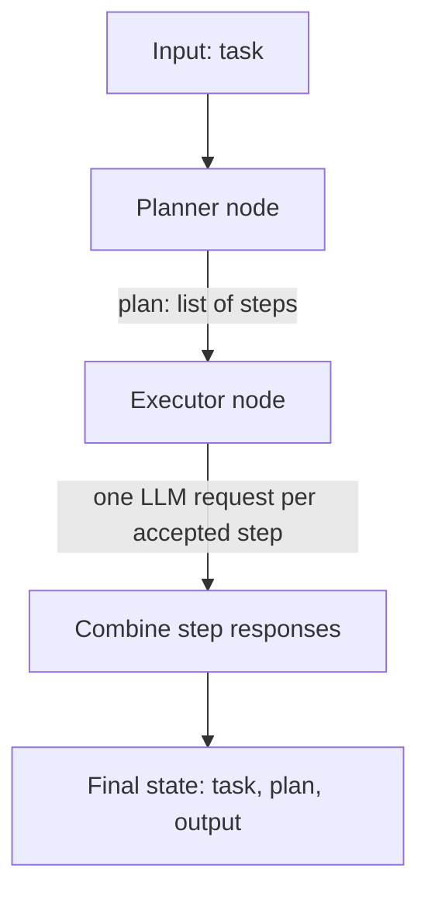

# Planner-Executor Pattern

This guide explains the planner-executor workflow in this repository. It is
written for someone new to the project and follows the implementation in
`patterns/planner_executer/`.

## The basic idea

The workflow divides a task into two jobs:

- **Planner:** asks the language model to break the user's task into a short,
  ordered list of steps.
- **Executor:** asks the language model to complete each step in order and
  combines the answers into one result.

For example, for a task such as "prepare a beginner study plan," the planner
might produce steps for choosing topics, ordering them, and adding practice.
The executor then handles each step and returns the combined response.

In this project, the executor produces text with the language model. It does
not run shell commands, Python code, or external tools.

## How data moves through the workflow



The LangGraph graph is linear: planner, then executor, then the end. There is
no loop that revises the plan or checks whether a step's result is correct.

## The shared state

`patterns/planner_executer/state.py` defines the data passed between nodes:

```python
class PlanState(TypedDict):
    task: str
    plan: List[str]
    output: str
```

Think of the state as a dictionary:

- `task` is the original request, such as `"Explain Python basics"`.
- `plan` is a list of step strings produced by the planner.
- `output` is the executor's combined answer.

The graph starts with `{"task": "..."}`. LangGraph merges each node's returned
fields into the state, so the final result contains the input task and the
planner and executor outputs.

`TypedDict` documents the expected shape for Python tools; it does not validate
the data at runtime.

## What each file does

- `patterns/planner_executer/state.py` defines the shared state shape.
- `patterns/planner_executer/node.py` contains the `planner` and `executor`
  node functions.
- `patterns/planner_executer/graph.py` registers the nodes and connects them
  in order.
- `patterns/planner_executer/run.py` builds the graph, invokes it with an
  example task, and prints the result as JSON.
- `config/llm.py` creates the OpenAI chat model used by both nodes.

The folder is spelled `planner_executer` in the current code. Keep that spelling
when importing the package.

## Step by step

### 1. The graph starts with the planner

`build_graph()` in `graph.py` creates a `StateGraph` using `PlanState`, adds the
`planner` and `executor` nodes, sets `planner` as the entry point, and connects
the planner to the executor. The executor connects to `END`.

### 2. The planner creates a list

`planner(state)` in `node.py` reads `state["task"]` and puts it into a prompt.
The prompt asks the model to:

- make at most three steps;
- start each step with a dash (`-`);
- avoid extra explanations in the plan.

The model response is stripped of whitespace and split at newline characters.
That list is returned as `{"plan": plan}` and saved in the graph state.

### 3. The executor handles the plan sequentially

`executor(state)` loops over `state["plan"]`, one item at a time. It trims each
step and skips it if it is blank or does not start with `-`. For each accepted
step, it makes another language-model request asking for a clear, concise
completion. The response is appended to a results list.

The executor joins those responses with a blank line and returns
`{"output": ...}`. With three accepted steps, this stage makes three model
requests. Together with the planner request, a normal run therefore makes four
requests, assuming each request succeeds.

### 4. The runner prints the final state

`run.py` calls `build_graph()` and invokes the graph with a task. It uses
`json.dumps(..., indent=2)` to print the complete result in a readable format.

## Run it on Windows

From the repository root, install the project dependencies in the virtual
environment and run the example:

```powershell
python -m venv .venv
.\.venv\Scripts\Activate.ps1
python -m pip install -r requirements.txt
python -m patterns.planner_executer.run
```

The model configuration reads `OPENAI_API_KEY` from `.env` or the process
environment. `OPENAI_MODEL` is optional and defaults to `gpt-4o`. For example,
the `.env` file can contain:

```dotenv
OPENAI_API_KEY=your-api-key
OPENAI_MODEL=gpt-4o
```

Do not commit `.env` or share the API key. A key that is missing or rejected by
the API prevents the model calls from succeeding.

## Try a different task

Edit the `task` value near the bottom of
`patterns/planner_executer/run.py`, then run the same command again. The runner
currently uses this example:

```python
task = "Create a simple 3-step plan for launching an AI chatbot product."
```

You can also call the graph from another Python module:

```python
from patterns.planner_executer.graph import build_graph

app = build_graph()
result = app.invoke({"task": "Explain how a bicycle works."})
print(result["output"])
```

## Current limitations

- **Three steps are requested, not enforced.** The model is prompted to return
  at most three steps, but the code does not truncate or validate the plan size.
- **Only dash-prefixed lines are executed.** The executor silently skips other
  lines instead of reporting a malformed plan.
- **Steps are sequential.** Each step waits for the previous model response;
  there is no parallel execution.
- **The executor returns generated text.** It does not use tools or verify the
  answer against outside sources.
- **There is no retry or replanning path.** If a model request fails, the graph
  does not repair the plan or continue with another route.
- **The planner is not a security boundary.** Model output is not validated as
  factual or safe just because it is formatted as a plan.

These are useful next improvements if you extend the pattern: validate the
number and format of plan steps, add clear error handling, and define a way to
check whether the final output satisfies the original task.